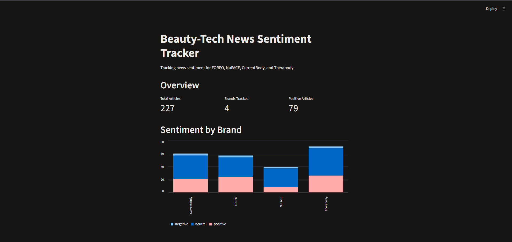
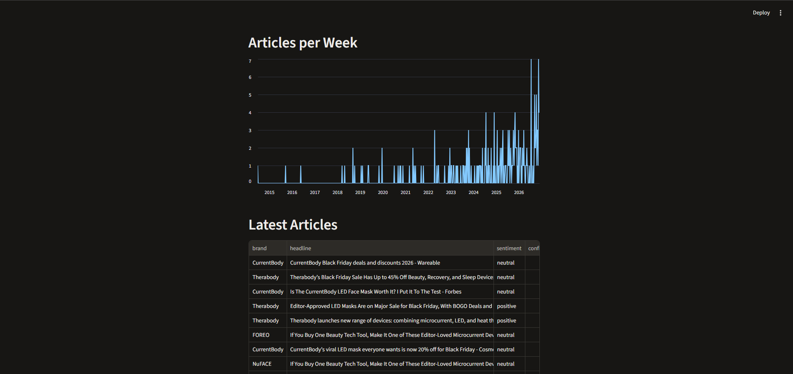

# Beauty-Tech News Sentiment Tracker

A Python project that collects news headlines about beauty-tech brands and uses a pretrained AI model to analyze their sentiment.

The project tracks four brands: **FOREO, NuFACE, CurrentBody, and Therabody**.

## Features

- Collects news headlines from Google News RSS.
- Organizes and cleans article data using pandas.
- Removes duplicate articles.
- Classifies headlines as positive, neutral, or negative.
- Saves results in CSV files and preserves previously analyzed articles.
- Displays results in a Streamlit dashboard.
- Includes automated tests using pytest.

## Technologies Used

- **Python** — Main programming language
- **feedparser** — Reading RSS feeds
- **pandas** — Data cleaning and analysis
- **Hugging Face Transformers** — Sentiment analysis
- **PyTorch** — Running the AI model
- **Streamlit** — Dashboard
- **pytest** — Automated testing

The sentiment model is [cardiffnlp/twitter-xlm-roberta-base-sentiment](https://huggingface.co/cardiffnlp/twitter-xlm-roberta-base-sentiment).

## Installation

Python 3.13 was used during development.

1. Clone the repository:

   ```bash
   git clone https://github.com/ShahedHasan0/Beauty-Tech-Sentiment-Tracker.git
   ```

2. Open the project folder:

   ```bash
   cd Beauty-Tech-Sentiment-Tracker
   ```

3. Create a virtual environment:

   ```powershell
   py -m venv .venv
   ```

4. Activate it in Windows PowerShell:

   ```powershell
   .\.venv\Scripts\Activate.ps1
   ```

5. Install the required libraries:

   ```powershell
   python -m pip install -r requirements.txt
   ```

## How to Run

**1. Collect news headlines**

```powershell
python src/news_collector.py
```

This saves the collected headlines to `data/headlines.csv`.

**2. Analyze sentiment**

```powershell
python src/sentiment_analyzer.py
```

This classifies headlines and saves the results to `data/sentiment_results.csv`. Previously analyzed articles are retained, and new articles receive a collection timestamp.

**3. Open the dashboard**

```powershell
python -m streamlit run app.py
```

Open `http://localhost:8501` in your browser.

## Dashboard

The dashboard displays:

- Sentiment counts by brand
- Articles published per week
- Latest headlines and their sentiment predictions
- Summary statistics

### Screenshot




## Running Tests

Run the automated tests using:

```powershell
python -m pytest tests/ -v
```

The tests check the news collector and sentiment analysis functions.

## Limitations

- Sentiment is predicted from headlines, not full articles.
- The model may occasionally classify headlines incorrectly.
- News availability depends on Google News RSS.
- Articles can appear under more than one brand.

## Possible Improvements

- Improve the relevance of collected headlines.
- Evaluate sentiment predictions against manually labeled examples.
- Add more detailed historical trend comparisons.

## Author

Developed by Shahed Hasan as a Python portfolio project.